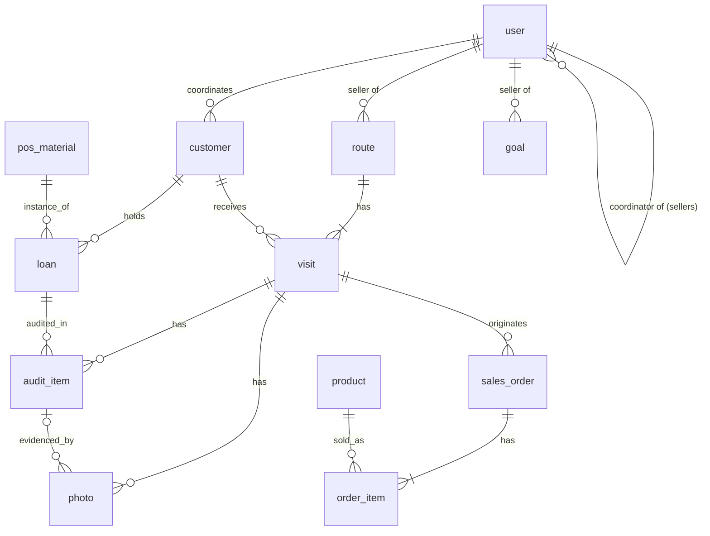

# Modelo de Dados — AXIS

Modelo de domínio e de dados decidido na issue [#26](https://github.com/doneres/projeto-integrador-2026.2/issues/26). É a fonte para o schema Drizzle (`apps/api`) e para os schemas Zod de `packages/contracts`.

- O **glossário** (linguagem do domínio, em português) está em [`CONTEXT.md`](../../CONTEXT.md).
- **Nomes em inglês** em tabelas, colunas, schemas Zod, JSON e rotas da API (ver [ADR 0001](../adr/0001-codigo-e-api-em-ingles.md)). Só o texto da interface e os caminhos de página do web ficam em português.
- Banco: tabelas em `snake_case`; código TypeScript em `camelCase`.

## Glossário ↔ código

| Termo (CONTEXT.md) | Nome no código |
|---|---|
| Vendedor, Coordenador, Diretor, Administrador | `user` com `role` = `seller`, `coordinator`, `director`, `administrator` |
| Equipe | não é tabela: um `coordinator` e os `seller` com `coordinatorId` apontando para ele |
| Cliente | `customer` |
| Rota | `route` |
| Visita | `visit` |
| Material de PDV | `pos_material` |
| Comodato | `loan` |
| Auditoria de PDV | `audit_item` (uma linha por Comodato auditado na Visita) |
| Foto | `photo` |
| Produto | `product` |
| Pedido | `sales_order` (`order` é palavra reservada do SQL) e `order_item` |
| Meta | `goal` |
| Parâmetros do sistema | `system_settings` |

## Diagrama

## Entidades

Convenções: todo `id` é UUID v7; toda tabela tem `createdAt` e `updatedAt`; instantes em UTC; dinheiro em centavos (`...Cents`). Colunas marcadas com `*` podem ser geradas no aparelho (offline) e carregam `occurredAt` (relógio do aparelho).

### `user`

| Coluna | Notas |
|---|---|
| `id` | |
| `name` | |
| `email` | único |
| `registration` | matrícula, único; login por e-mail ou matrícula |
| `passwordHash` | argon2 |
| `role` | `seller` \| `coordinator` \| `director` \| `administrator` |
| `coordinatorId` | FK `user`; obrigatório e só permitido quando `role = seller`, e deve apontar para um `coordinator` |
| `active` | conta inativa perde o acesso na hora (conferido a cada requisição) |

Usuário nunca é excluído, só desativado.

### `customer`

| Coluna | Notas |
|---|---|
| `legalName`, `tradeName` | |
| `document` | CPF/CNPJ sem máscara; único **entre clientes com `status` ≠ `rejected`** (índice parcial) |
| `phone`, `contactName` | |
| `zipCode`, `street`, `number`, `complement`, `district`, `city`, `state` | endereço |
| `latitude`, `longitude` | obrigatórias; informadas pelo Coordenador (carteira) ou capturadas pelo GPS do aparelho (prospecção) |
| `origin` | `portfolio` \| `prospect`; imutável |
| `status` | `pending_approval` \| `active` \| `rejected` \| `inactive` |
| `coordinatorId` | dono do cliente (a Equipe); numa prospecção é o coordenador do vendedor no momento do cadastro |
| `createdById` | quem cadastrou |
| `approvedById`, `approvedAt` | preenchidos na aprovação; `approvedAt` define o mês do "novo cliente" |
| `rejectionReason` | obrigatório quando `status = rejected` |
| `occurredAt`* | só prospecção criada no app |

Estados:

- `portfolio`: nasce `active`; `active` ⇄ `inactive`.
- `prospect`: nasce `pending_approval` → `active` (aprovada) ou `rejected` (recusada, com motivo, fica no histórico); depois de ativa, `active` ⇄ `inactive`.
- Só `active` entra em rota, recebe visita e pedido. A API rejeita pedido de prospecção pendente (RN04).

Visibilidade: o Coordenador vê e edita os clientes da sua equipe; o Diretor vê todos; o Vendedor vê só os clientes das suas rotas e as prospecções que ele criou.

### `route`

| Coluna | Notas |
|---|---|
| `sellerId` | FK `user` (`seller`) |
| `date` | data de calendário, fuso America/Sao_Paulo |
| `createdById` | Coordenador que montou |

- Único (`sellerId`, `date`).
- O vendedor e todos os clientes da rota precisam ser da equipe do Coordenador que a cria.
- Exclusão real só se nenhuma visita tem check-in; as visitas vão junto.

### `visit`

A linha nasce com a rota, em estado Pendente. Check-in e check-out só preenchem colunas dela.

| Coluna | Notas |
|---|---|
| `routeId`, `customerId` | único (`routeId`, `customerId`) |
| `position` | ordem manual definida pelo Coordenador |
| `checkedInAt`* | instante do check-in |
| `checkInLatitude`, `checkInLongitude`, `checkInAccuracyMeters` | leitura do GPS |
| `checkInDistanceMeters` | distância calculada até o cliente |
| `checkInStatus` | `on_site` \| `out_of_radius`; **gravado**, porque o raio é parâmetro e muda |
| `checkInJustification` | obrigatória quando `out_of_radius` |
| `checkedOutAt`* | |
| `outcome` | `sale_made` \| `audit_only` \| `customer_closed` \| `not_performed` |
| `outcomeJustification` | obrigatória em `customer_closed` e `not_performed` |
| `summary` | resumo do atendimento |

**Estado derivado, sem coluna** (helper compartilhado, também usado nos filtros SQL):

| Estado | Condição |
|---|---|
| Pendente | sem `checkedInAt` |
| Em andamento | com `checkedInAt`, sem `checkedOutAt` |
| Concluída | com check-out e `outcome` em `sale_made` ou `audit_only` (é a "Visita realizada" da Meta) |
| Não realizada | com check-out e `outcome` em `customer_closed` ou `not_performed` |

**Flag de auditoria** = `checkInStatus = out_of_radius`; é um indicador derivado, sem tabela nem fluxo de revisão. Check-out exige check-in; o bloqueio da RN03 (fotos e estados dos itens) vale antes do check-out, inclusive offline. Não existe visita fora de rota.

### `pos_material` (catálogo, Administrador)

`name`, `category` (texto: geladeira, freezer, banner, display, totem...), `active`. Exclusão real só sem nenhum `loan` ativo.

### `loan` (Comodato)

| Coluna | Notas |
|---|---|
| `materialId`, `customerId` | |
| `serialNumber` | patrimônio ou série |
| `installedAt` | data |
| `endedAt` | nulo = ativo; encerrar preserva o histórico |

Só o Administrador cria e encerra. A auditoria **não** altera o comodato.

### `audit_item` (Auditoria de PDV)

Sem cabeçalho: "a auditoria foi feita" = existem `audit_item` na visita.

| Coluna | Notas |
|---|---|
| `visitId`, `loanId` | único (`visitId`, `loanId`); uma linha por comodato ativo do cliente |
| `condition` | `intact` \| `damaged` \| `missing` \| `needs_maintenance` |
| `justification` | texto obrigatório quando `missing` |
| `occurredAt`* | |

Cliente sem comodato não passa por auditoria nem RN03.

### `photo`

| Coluna | Notas |
|---|---|
| `visitId` | obrigatório; a RN03 exige ao menos 1 por visita (com comodato) |
| `auditItemId` | opcional; obrigatório para `damaged` e `needs_maintenance` |
| `storageKey` | chave do objeto no armazenamento externo |
| `takenAt`* | |

O fluxo de upload (linha criada antes ou depois do envio do arquivo) fica no ticket de sync offline (#27).

### `product` (catálogo, Administrador)

`sku` (único), `name`, `category` (texto), `unitPriceCents`, `referenceStock` (inteiro), `imageUrl` (opcional), `active`.

### `sales_order` e `order_item`

| Tabela | Colunas |
|---|---|
| `sales_order` | `visitId` (obrigatório), `occurredAt`* |
| `order_item` | `orderId`, `productId`, `quantity`, `unitPriceCents` (copiado do produto na emissão); único (`orderId`, `productId`) |

- Cliente e vendedor vêm da visita. O total é a soma dos itens (sem coluna).
- Sem status, cancelamento, desconto, forma de pagamento nem crédito (#25, #48).
- O pedido só é aceito com a visita em andamento e o cliente `active`.
- Faturamento do mês = pedidos cujo `occurredAt` cai no mês (America/Sao_Paulo).

### `goal` (Meta)

| Coluna | Notas |
|---|---|
| `sellerId` | |
| `month` | primeiro dia do mês; único (`sellerId`, `month`) |
| `revenueTargetCents`, `visitsTarget`, `newCustomersTarget` | cada um **opcional**; nulo = "sem meta" naquele indicador |
| `setById` | Diretor |

O **realizado e o score são calculados na leitura** (pedidos, visitas concluídas, prospecções aprovadas no mês), sem gravar nada. Consequência aceita: mudar os pesos altera o score dos meses passados.

### `system_settings` (Parâmetros do sistema)

Linha única: `checkinRadiusMeters` (padrão 100), `scoreWeightRevenue` (50), `scoreWeightVisits` (30), `scoreWeightNewCustomers` (20), com CHECK de soma = 100; `updatedById`. Só o Administrador altera.

## O que não é tabela

| Conceito | Como se obtém |
|---|---|
| Equipe | `user.coordinatorId` |
| Estado da visita | derivado (tabela acima) |
| Flag de auditoria | `visit.checkInStatus = out_of_radius` |
| Visita realizada, Score | calculados na leitura |
| Total do pedido | soma de `order_item` |
| Token e sessão | JWT de 8 h; nada no banco |

## Exclusão e histórico

| Entidade | Regra |
|---|---|
| `user`, `customer` | só inativa |
| `route` | exclusão real se nenhuma visita tem check-in |
| `pos_material` | exclusão real sem `loan` ativo |
| `loan` | encerra (`endedAt`) |
| demais | não se excluem |

## Pendências para outros tickets

- **Sync offline (#27):** upload de `photo`; o que o servidor faz com pedido ou auditoria cujo check-in não chegou (rejeitar ou marcar inconsistente); ordem da fila por `seq` local (RN05).
- **Contrato da API:** `packages/contracts` e o web usam nomes em português e `tipo`/`status` simples; precisam ser renomeados para este modelo (implementação, fora do mapa).
