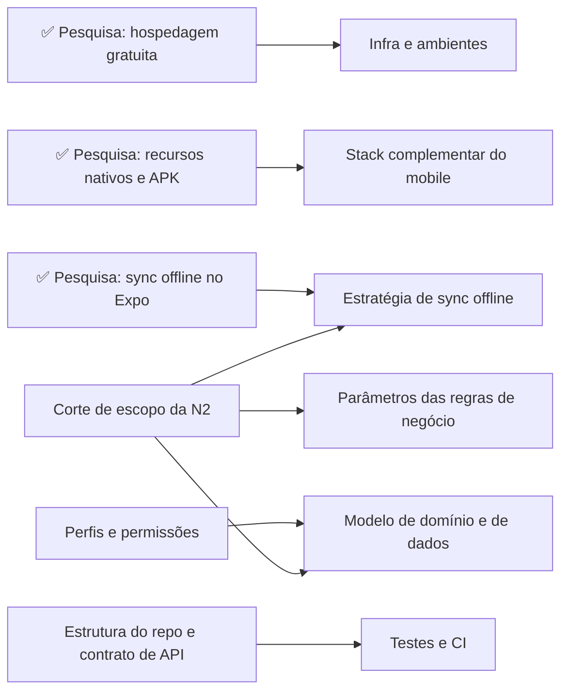

# Wayfinder: como fechamos as decisões antes de codar

Este documento explica o que é o **mapa de decisões** que está nas issues do repositório, como acompanhar o andamento dele e como participar, com ou sem o Claude Code.

A ideia é simples: **antes de abrir tickets de implementação, a gente fecha as decisões que travariam o trabalho em paralelo das três frentes** (mobile, backend e web). O wayfinder organiza essas decisões como issues no GitHub, uma por pergunta, e liga umas às outras por dependência.

## Resumo do fluxo

```
mapa (issue) → tickets de decisão → resolve um por sessão → mapa atualizado → ... → spec da N2 → tickets de implementação
```

O wayfinder **não produz código**. Cada ticket termina com uma **decisão registrada** (ou com fatos pesquisados que alimentam uma decisão). Quando não sobrar nada a decidir, geramos o spec (`/to-spec`) e, a partir dele, os tickets de implementação de cada frente (`/to-tickets`).

## O nosso mapa

**[\[MAPA\] AXIS: caminho até o spec da N2](https://github.com/doneres/projeto-integrador-2026.2/issues/18)**

**Destino:** um spec único do AXIS para a N2. O escopo precisa caber até o congelamento em 27/11 e vem dividido em **beta** (Checkpoint 2, 06/11) e **pós-beta**, com as decisões transversais travadas (repositório, contrato de API, sync offline, infra).

O corpo do mapa tem cinco seções:

| Seção | O que tem |
|---|---|
| **Destination** | Onde o mapa termina. Toda sessão começa relendo isso. |
| **Notes** | Contexto fixo: stack já decidida, prazos, base de requisitos, quem decide. |
| **Decisions so far** | Índice das decisões tomadas: uma linha por ticket fechado, com link. **O detalhe fica no ticket, não no mapa.** |
| **Not yet specified** | A "névoa": assuntos que sabemos que vão aparecer, mas que ainda não dá para formular como pergunta precisa. |
| **Out of scope** | O que conscientemente decidimos que **não** faz parte deste esforço. |

## Conceitos

### Ticket

Cada ticket é uma **sub-issue do mapa** com uma única seção `## Question`: a pergunta que ele resolve. A resposta não vai no corpo; ela é registrada como **comentário de resolução** quando o ticket é fechado.

### Tipos de ticket (label `wayfinder:*`)

| Label | Tipo | Quem conduz | Exemplo no nosso mapa |
|---|---|---|---|
| `wayfinder:research` | Pesquisa em fontes oficiais (docs, preços, repositórios) | Agente sozinho | Pesquisa: hospedagem gratuita da API, Postgres e fotos |
| `wayfinder:grilling` | Conversa de perguntas e respostas até fechar a decisão | Humano + agente | Corte de escopo da N2 e fatiamento beta/pós-beta |
| `wayfinder:prototype` | Protótipo rápido e descartável para reagir a algo concreto | Humano + agente | (nenhum ainda) |
| `wayfinder:task` | Trabalho manual que destrava uma decisão (criar conta, liberar acesso) | Depende | (nenhum ainda) |

Nos tickets de grilling, **quem responde é uma pessoa**. O agente pergunta e recomenda, mas nunca responde no lugar do humano.

### Bloqueio e fronteira

Os tickets usam as **dependências nativas do GitHub** ("Blocked by"), visíveis na própria issue. Um ticket está:

- **bloqueado**: algum ticket do qual ele depende ainda está aberto;
- **na fronteira**: está aberto, não está bloqueado e **ninguém está atribuído** a ele. É o que dá para pegar agora.

### Claim (atribuição)

Quem começa a trabalhar num ticket **se atribui a ele antes de qualquer coisa**. Ticket com responsável já está em andamento por alguém, então não pegue.

## Estado atual do mapa (12/10/2026)



*(A seta significa "precisa estar fechado antes de".)*

**Fechados (pesquisas):**
- [Pesquisa: persistência local e sync offline no Expo](https://github.com/doneres/projeto-integrador-2026.2/issues/22): recomenda expo-sqlite + Drizzle + fila *outbox* própria; WatermelonDB descartado.
- [Pesquisa: hospedagem gratuita da API, Postgres e fotos](https://github.com/doneres/projeto-integrador-2026.2/issues/23): Render Free + Neon Free + fotos no R2 ou Cloudinary.
- [Pesquisa: recursos nativos e build de APK no Expo](https://github.com/doneres/projeto-integrador-2026.2/issues/24): Expo SDK 57, react-native-maps + Google, APK pelo EAS.

Os arquivos completos dessas pesquisas estão em [`docs/pesquisas/`](../pesquisas/), com as fontes citadas.

**Na fronteira (pode pegar):**
- [Corte de escopo da N2 e fatiamento beta/pós-beta](https://github.com/doneres/projeto-integrador-2026.2/issues/19). É o que mais destrava; deve ser o próximo.
- [Perfis, permissões e cadastro de usuários](https://github.com/doneres/projeto-integrador-2026.2/issues/20)
- [Estrutura do repositório, tooling e contrato de API entre as frentes](https://github.com/doneres/projeto-integrador-2026.2/issues/21)
- [Infra e ambientes de dev e demo](https://github.com/doneres/projeto-integrador-2026.2/issues/28)
- [Stack complementar do mobile](https://github.com/doneres/projeto-integrador-2026.2/issues/29)

**Bloqueados:**
- [Parâmetros finais das regras de negócio](https://github.com/doneres/projeto-integrador-2026.2/issues/25): espera o corte de escopo.
- [Modelo de domínio e de dados](https://github.com/doneres/projeto-integrador-2026.2/issues/26): espera o corte de escopo e os perfis.
- [Estratégia de sync offline](https://github.com/doneres/projeto-integrador-2026.2/issues/27): espera o corte de escopo.
- [Estratégia de testes e CI por frente](https://github.com/doneres/projeto-integrador-2026.2/issues/30): espera a estrutura do repo.

Para ver o estado mais recente, abra o mapa: a lista de sub-issues mostra o que está aberto ou fechado e quem está atribuído.

## Como participar

### Sem Claude Code: acompanhando e opinando pelo GitHub

As decisões são tomadas pelo João Victor, mas **a opinião de quem vai implementar conta, e muito**. O jeito de entrar na conversa:

1. Abra o mapa e leia a seção **Decisions so far** para saber o que já foi decidido.
2. Abra os tickets **da sua frente** que ainda estão abertos e **comente** antes de serem resolvidos: restrições, preferências, experiências.
   - Douglas: estrutura do repo e contrato de API, infra, regras de negócio, modelo de dados, sync offline (lado da API).
   - Guilherme: estrutura do repo e contrato de API, perfis e permissões, testes e CI.
3. Quem resolver o ticket lê os comentários antes de começar.

Os comentários do Douglas no PR de requisitos sobre o raio do check-in já foram levados para o ticket de regras de negócio, por exemplo.

### Com Claude Code: resolvendo um ticket

**Pré-requisito:** ter o Claude Code instalado. As skills (`/wayfinder`, `/grilling`, `/research`, `/to-spec`, `/to-tickets`...) já vêm com o repositório, em `.claude/skills/` (e uma cópia em `.agents/skills/` para outros agentes).

1. Atualize sua `main` (`git checkout main && git pull`).
2. Abra uma **sessão nova** do Claude Code na raiz do projeto.
3. Rode:

   ```
   /wayfinder #18
   ```

   Sem indicar ticket, o agente pega o primeiro da fronteira. Para escolher um específico:

   ```
   /wayfinder #18 #21
   ```

4. O agente **se atribui ao ticket**, lê o mapa e conduz o trabalho:
   - **grilling**: faz uma pergunta por vez, sempre com uma resposta recomendada; você decide;
   - **research**: dispara um agente em segundo plano, que grava o resultado num `.md` em `docs/pesquisas/` (numa branch `research/<nome>`, que segue o fluxo normal de PR).
5. No fim, o agente:
   - posta a **resolução** como comentário no ticket e fecha a issue;
   - acrescenta uma linha no **Decisions so far** do mapa;
   - cria tickets novos que a decisão revelou, ou promove assuntos da névoa (**Not yet specified**) para tickets;
   - se descobrir que algo está além do destino, fecha o ticket e o move para **Out of scope**.

### Regras de convivência

- **Um ticket por sessão.** A exceção são as pesquisas, que podem rodar várias em paralelo.
- **Não pegue ticket com responsável.** Alguém já está nele.
- **Tickets da fronteira podem andar em paralelo**, em sessões diferentes. Espere edições concorrentes no mapa.
- **A decisão mora no ticket.** O mapa só tem um resumo de uma linha e o link. Para entender o porquê, leia o comentário de resolução.
- **Não edite o corpo do mapa à mão** sem avisar o time. Prefira comentar no ticket correspondente.
- **Mudou de ideia sobre algo já decidido?** Comente no ticket fechado e avise; se for necessário, abrimos um ticket novo no mapa para revisitar.

## Depois do mapa

Quando a fronteira esvaziar e a névoa não tiver mais nada dentro do destino:

1. **`/to-spec`**: sintetiza as decisões num spec único (histórias de usuário, decisões de implementação, contratos, decisões de teste, fora do escopo), publicado como issue.
2. **`/to-tickets`**: quebra o spec em tickets de implementação por frente (mobile, backend, web), marcados como beta ou pós-beta.
3. A partir daí, volta o fluxo normal de [branch e Pull Request](./README.md).

## Perguntas frequentes

**Por que não começar a codar logo?**
Porque três pessoas vão codar em paralelo contra o mesmo contrato. Decisões como "monorepo ou não", "como o app sincroniza offline" e "qual o formato de erro da API" mudam o código de todo mundo. Decidir depois sai mais caro do que decidir agora.

**O que é a "névoa" (Not yet specified)?**
Assuntos que sabemos que vão aparecer, mas que dependem de decisões ainda abertas. Exemplo: "rota otimizada" só vira ticket de pesquisa se o corte de escopo decidir mantê-la.

**Onde estão os diagramas UML e o DER?**
Fora do escopo do mapa como artefato acadêmico: serão gerados a partir do spec e do código. O **modelo de dados**, em si, é decidido no ticket "Modelo de domínio e de dados".

**Posso criar um ticket novo no mapa?**
Pode, se a pergunta for precisa e estiver dentro do destino. Crie como sub-issue do mapa, com o label `wayfinder:<tipo>` e a seção `## Question`, e ligue as dependências. Se a pergunta ainda for vaga, comente no mapa para entrar em **Not yet specified**.
